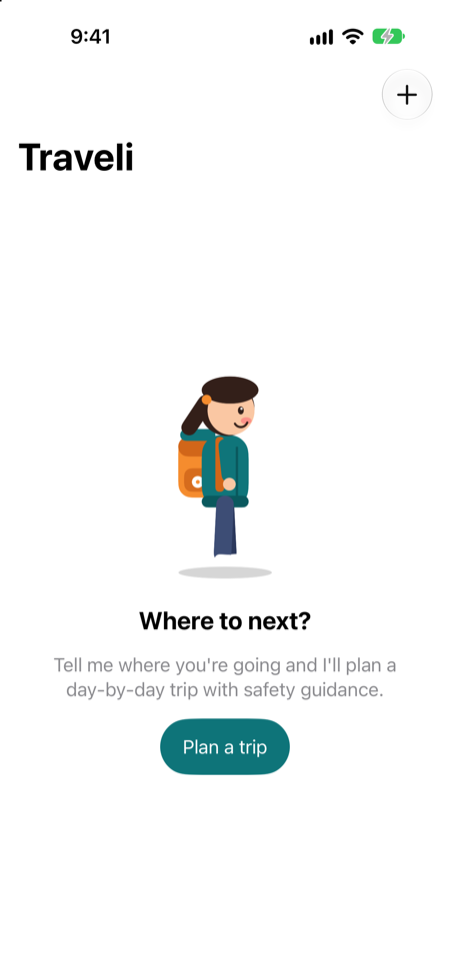
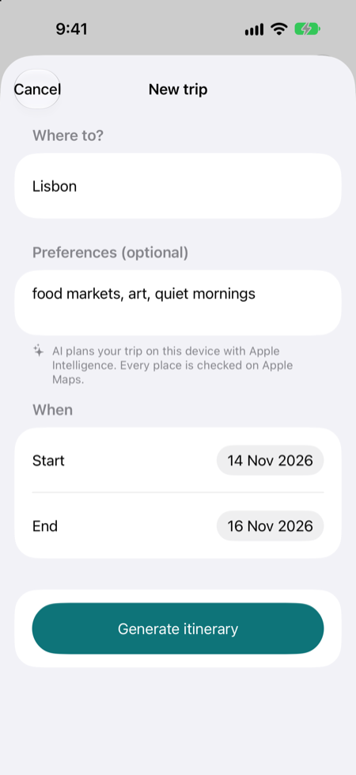
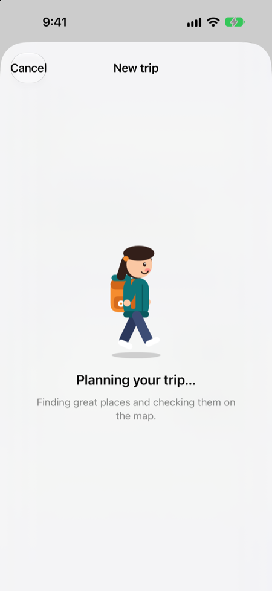
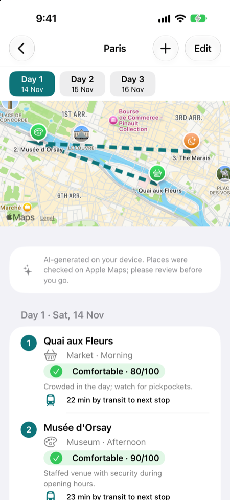
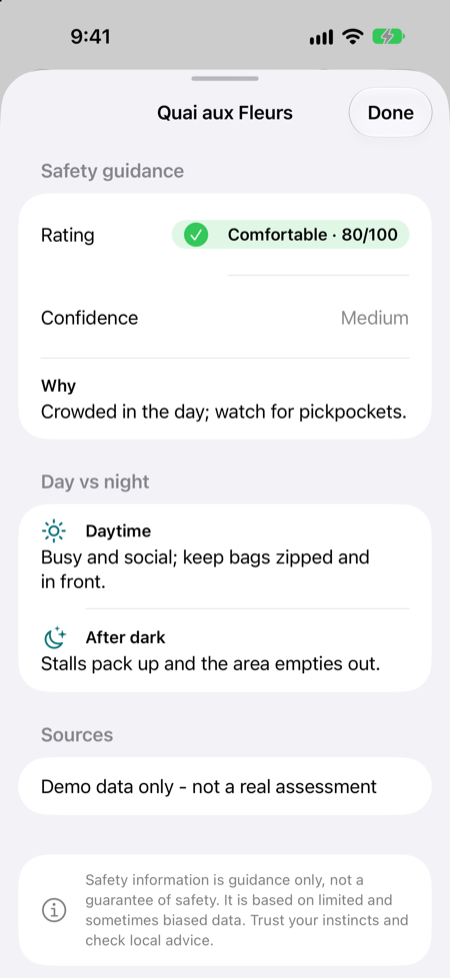
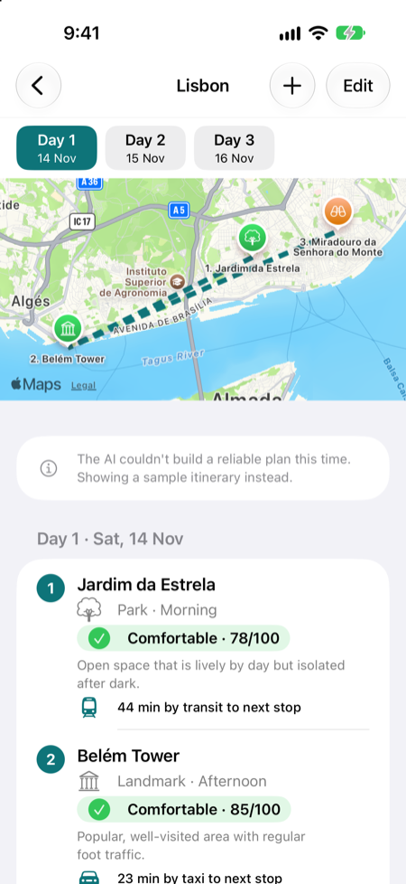

# Traveli

A solo-women's travel assistant for iPhone. Enter a destination and dates, get a day-by-day itinerary on a map, customise it, and see calm, honest **safety guidance** for every stop.

> **Status:** itineraries are generated by **on-device AI** (Apple Intelligence via the Foundation Models framework) when available, with a sample-itinerary fallback. Safety scores are still **mock** data, clearly labelled in the UI. Every external dependency sits behind a protocol so real services can be swapped in without touching views or view models.

Swift 5 · SwiftUI · SwiftData · MapKit · iOS 17+ · no third-party dependencies · no API keys.

## Screenshots

| Home | New trip | Planning |
| :---: | :---: | :---: |
|  |  |  |
| Traveli's animated traveller greets you | Optional preferences, with an honest note on AI availability | The traveller walks while the on-device AI plans |

| AI itinerary | Safety detail | Graceful fallback |
| :---: | :---: | :---: |
|  |  |  |
| Map, route, commute times and safety bands; every place verified on Apple Maps | Rating, confidence, reason, day vs night, sources and a disclaimer | If the AI can't build a reliable plan, the app says so and shows a sample instead |

_Screenshots are from the iPhone 18 Pro simulator (iOS 27.2). Safety scores are demo data and are labelled that way in the app. The fallback screenshot is a real run, not staged._

## Run it

Requires Xcode 15+ (Xcode 16 recommended).

```bash
open Traveli.xcodeproj
```

Pick an iPhone simulator (e.g. iPhone 16) and press **⌘R**. Press **⌘U** to run unit tests.
Try "Lisbon", "Paris" or "Tokyo" for hand-written content. Any other city works too (placeholder stops around the city centre, found via MapKit).

The project is generated from [`project.yml`](project.yml) with [XcodeGen](https://github.com/yonaskolb/XcodeGen). If you add or move files: `brew install xcodegen && xcodegen generate`.

## Features

0. **Meet Traveli** - an animated cartoon traveller with a backpack (drawn in code with SwiftUI `Canvas`, respects Reduce Motion) greets you on the empty screen and walks while your trip is planned.
1. **Trip form** - destination, dates and optional preferences, validation, loading and error states.
1a. **AI itinerary** - on-device model plans one day at a time using guided generation (structured output, no free-text parsing). Every suggested place is looked up on Apple Maps and dropped if it doesn't exist near the destination, so names and coordinates always come from the map. If AI is unavailable or fails, a sample itinerary is used and the reason is shown. No API key, no server, nothing leaves the device.
2. **Itinerary** - a day picker, MapKit map (numbered markers tinted by safety band, route line), ordered stops with time slot, category, commute to next stop and safety badge.
3. **Customise** - add a place via MapKit local search, swipe to delete, Edit to drag-reorder. Changes persist in SwiftData and commute times are recalculated.
4. **Safety guidance** - band (Comfortable / Take care / Limited data), score, short reason, day-vs-night notes, confidence, sources, and an always-visible disclaimer.
5. **Offline** - trips are stored locally; saved itineraries open without a network, an offline banner explains what's unavailable, and commute estimates fall back to a local heuristic.

## Architecture

MVVM with protocol-based services and one composition root (`AppEnvironment`).

```
SwiftUI Views ───────────────► ViewModels (@Observable, @MainActor)
 TripListView                    TripFormViewModel
 TripFormView                    ItineraryViewModel
 ItineraryView / PlaceRow        PlaceSearchViewModel
 AddPlaceView / PlaceDetailView        │
        │                              ▼
        │                        TripPlanner  (turns service output into models)
        │                              │
        │            ┌─────────────────┼──────────────────┐
        │            ▼                 ▼                  ▼
        │   ItineraryService   SafetyScoringService   RoutingService     PlacesService
        │   └ MockItinerary…   └ MockSafetyScoring…   ├ MapKitRouting…   └ MapKitPlaces…
        │                                             └ HeuristicRouting… (offline fallback)
        ▼
 SwiftData models: Trip ─┬─< Day ─┬─< Place     (cascade delete; order via Place.order)
```

Design notes:

- **Services return plain `Sendable` values** (`DayProposal`, `SafetyAssessment`, `CommuteEstimate`, `PlaceSuggestion`), never SwiftData objects. A future LLM backend only has to return JSON that decodes to `DayProposal`.
- **`TripPlanner`** is the single place that composes itinerary + safety + routing into `Trip/Day/Place`, so view models stay small.
- **SwiftData relationships are unordered**, so `Place.order` is the source of truth and `Day.sortedPlaces` is the only way views read places.
- **Routing never throws**: MapKit ETA first, local heuristic on any failure, so editing works offline.
- **No UI in the model layer**: icons, colours and wording live in `Views/Components/Presentation.swift`.

```
Traveli/
  App/         TraveliApp, AppEnvironment (composition root)
  Models/      Trip, Day, Place, enums, GeoPoint
  Services/    protocols, AI + mock + MapKit implementations, StopVerifier, TripPlanner
  ViewModels/  TripForm, Itinerary, PlaceSearch
  Views/       screens + Components/
  Support/     NetworkMonitor, PreviewData
TraveliTests/ model, service and view-model tests
```

## Accessibility

VoiceOver: each stop is one element with a full spoken summary (stop number, category, safety band/score/confidence, reason, commute) and a hint. Safety is never colour-only: every band has an icon and text. Dynamic Type via system text styles, 44 pt minimum tap targets, light/dark via semantic colours and an accent colour with a dark variant.

## Tests

`TraveliTests` covers the data model (ordering, cascade delete, band rules), mock itinerary/safety/routing services (determinism, validation, edge cases), `TripPlanner`, and the view models (add / delete / reorder with commute recalculation, form and search states) using an in-memory `ModelContainer`.

## Evaluation: a controlled prompt experiment

The AI itinerary's prompt was tested like a research question, not tuned by feel (course concepts: experimental
design and statistics for human-centred AI).

- **Question:** does an explicit "keep stops within 3 km" instruction make AI days more compact, without
  hurting the share of suggestions that are real places?
- **Design:** within-subjects, 20 destinations x 3 prompts x 3 days, Latin-square counterbalanced, destination as
  the unit of analysis, hypotheses and decision rules written down before the run
  ([`Evaluation/EXPERIMENT.md`](Evaluation/EXPERIMENT.md)).
- **Pipeline:** a testable AI service (injectable model, per-day metrics), a rate-limited experiment runner, and a
  dependency-free Python analysis (paired t-test, Cohen's d_z, repeated-measures ANOVA with Greenhouse-Geisser,
  Wilcoxon, Bonferroni, power analysis) checked against published critical values (30 Python tests).
- **Result:** the pre-registered hypotheses were **not supported** (compact - baseline = +1.09 km, 95% CI
  [-0.36, 2.54], p = .131; non-inferiority inconclusive). The study was underpowered for effects this small (about
  61 destinations needed). An exploratory finding: dropping the safety and geography guidance
  ("minimal" prompt) lowered the real-place rate from 0.86 to 0.72 (d_z = 0.67) and usable days from 0.93 to
  0.69. Full tables and charts: [`Evaluation/results/report.md`](Evaluation/results/report.md).

```bash
python3 -m unittest discover -s Evaluation -p "test_*.py"                        # statistics + analysis tests
python3 Evaluation/analyze.py Evaluation/results/experiment.csv --out Evaluation/results   # regenerate the report
```

## Privacy and safety-score bias

- **Privacy:** trips live only on the device (SwiftData). The app has no accounts, analytics or API keys, and does not request your location. Destination and place searches go to Apple Maps (MapKit) only.
- **Safety scores are guidance, not guarantees.** The current numbers are category-based demo data, labelled as such.
- **Bias is a real risk** for any future real scoring: crime and incident data reflects reporting and policing patterns, can stigmatise neighbourhoods by income or ethnicity, and is thin outside well-mapped tourist areas. Mitigations designed in: gentle bands (we never say "unsafe"), an explicit **Limited data** band, a **confidence** level that hides the number when low, source citations, a day-vs-night split, and a persistent disclaimer. Real data should be reviewed for bias before launch, and users should be able to report wrong or unfair assessments.

## Limitations

- AI itineraries need iOS 26+ with Apple Intelligence enabled; otherwise a sample is used. The on-device model can be slow (about a few seconds per day) and may suggest less-than-perfect plans; places are verified to exist, but opening hours and distances between stops are not.
- AI plans can fall back to a sample. In the prompt experiment, 17 of 20 three-day plans (85%) with the shipped prompt had every day usable; in the rest, one weak day (fewer than two verified places) makes the whole plan unreliable, so the app shows a sample and says why. Keeping the good days and retrying only the weak one is the obvious next improvement.
- Safety data is mock. Sample itineraries for unknown destinations are generic placeholder stops.
- Max 14 days per trip. Time slots stay with a place when reordered.
- Map tiles and place search need a network; saved trips and their data do not.
- English only (strings aren't localised yet). iPhone, portrait only.
- Unit tests only; no UI tests yet.

## Roadmap (designed for, not built)

- **Server-side AI itinerary** for devices without Apple Intelligence: `ItineraryService` backed by a small backend calling an LLM that returns structured JSON (the on-device path and `StopVerifier` already exist).
- **Real safety score:** rule-based formula over structured signals (time of day, lighting/busy-ness from OpenStreetMap, government advisories, open crime data) with RAG-generated, cited explanations and a confidence value, precomputed and cached. Slots into `SafetyScoringService` / `SafetyAssessment` (`sources` and `confidence` already exist).
- **Apple Watch:** check-in timer, "I'm OK" / "I need help" with haptics.
- Live Activity, widget, App Intents / Siri, optional macOS companion.
